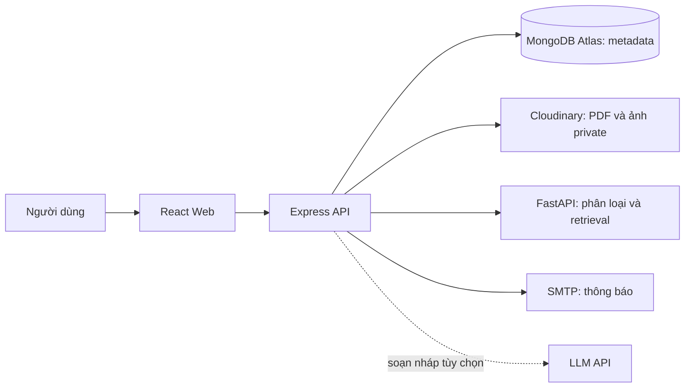

# Kiến trúc CaseFlow

CaseFlow tập trung quản lý yêu cầu hỗ trợ sinh viên có AI đề xuất. Không phải HRM đầy đủ hoặc hệ sinh thái quản trị toàn trường.

## Thành phần

- Web: tạo/theo dõi yêu cầu, hàng đợi, xử lý, tri thức, nhân sự gọn và quản trị tài khoản.
- API: xác thực, quyền tài nguyên theo tổ chức, validation, SLA, lưu metadata, kiểm soát tệp và background jobs.
- Atlas: tài khoản, phiên, hồ sơ, timeline, tri thức, notifications, audit và metadata tệp. Nội dung đính kèm không lưu Base64 trong MongoDB.
- Cloudinary: original PDF/ảnh authenticated. Metadata ghi provider/public ID, kích thước, uploader và case; download đi qua kiểm tra quyền API.
- FastAPI: baseline local và retrieval; dữ liệu nghiệp vụ chưa đủ điều kiện training. LLM không bắt buộc để sử dụng sản phẩm.

## Quyền và nhân sự

- Requester chỉ truy cập hồ sơ của mình; agent xử lý trong team; manager có quyền điều phối theo chính sách tổ chức.
- CNTT dùng org_admin quản trị tài khoản. Có thể cấp capability personnelManager cho nhân viên nhân sự mà không cấp quyền tạo tài khoản/nâng vai trò.
- Nhân sự chỉ phục vụ chuyên môn, năng lực, lịch/vắng mặt và phân công; không tính lương/chấm công.
- Không tự duyệt nghỉ. Đơn đã duyệt không cho nhân viên tự hủy; giữ lịch sử người duyệt. Hiện chỉ hỗ trợ hủy đơn pending chưa diễn ra, chưa có quy trình thu hồi đơn approved.

## Vòng đời và độ bền

FSM: new → triaged → in_progress ↔ waiting → resolved → closed. Mở lại tạo chu kỳ SLA mới. Người phụ trách không hợp lệ/vắng mặt không tự được giao lại. Hồ sơ trùng liên kết tới hồ sơ chính, giữ nguyên quyền của từng hồ sơ.

Tạo hồ sơ không chờ AI; background triage ghi kết quả có kiểm tra phiên bản và không ghi đè quyết định con người. Email có outbox/retry. Audit không chứa token/mật khẩu hoặc toàn bộ payload nhạy cảm.

Upload đặt chỗ quota và ID tác vụ trong cùng cập nhật hồ sơ trước khi ghi byte. API nhận Idempotency-Key theo tổ chức/người gửi/hồ sơ; cùng mã và nội dung trả lại metadata đã ghi, khác nội dung bị từ chối. Trình duyệt giữ mã khi còn cùng đối tượng File để thử lại, không bảo đảm giữ mã sau khi tải lại toàn trang. Tác vụ nền thu hồi upload quá hạn theo lô nhỏ, không xóa tệp đã có metadata; lỗi kho tệp giữ dấu vết và thử lại sau. Khi upload lỗi, quota có thể được giữ tạm trong lúc chờ thu hồi. Đây không phải transaction phân tán hay đối soát toàn bộ tệp mồ côi cũ trên Cloudinary.

Tài liệu công bố có phiên bản và thời gian hiệu lực. Các route cho requester đều phải kiểm tra visibility; xem lịch sử của staff là quyền riêng với tra cứu hướng dẫn đang áp dụng.

## Phạm vi đóng băng

Incident tự phát hiện, SLA predictive trên dữ liệu thật, HRM đầy đủ và tự retrain chưa là cam kết sản phẩm. Crawler/OCR PTIT đã gỡ; benchmark vẫn là công cụ nghiên cứu thủ công. Không thêm service queue/vector database nếu chưa có nhu cầu được đo.

Nhân sự và nghỉ phép được phân trang phía server. Thống kê nhân sự dùng người phụ trách hiện tại và lần giải quyết hiện tại trong 30 ngày; không dùng làm bảng xếp hạng hiệu suất. Báo cáo SLA theo đơn vị dùng từng chu kỳ giải quyết, bao gồm lịch sử mở lại. Đúng hạn so với dueAt đã lưu, không tính lại theo danh mục dịch vụ mới.

Production định hướng Atlas + Cloudinary. Local Mongo và S3 cũ chỉ là profile tương thích; không xóa volume khi chưa kiểm kê attachment cũ. Backup S3 offsite đã bỏ khỏi cấu hình; phương án khôi phục Atlas/Cloudinary cần được kiểm chứng riêng trước dùng dữ liệu thật.
